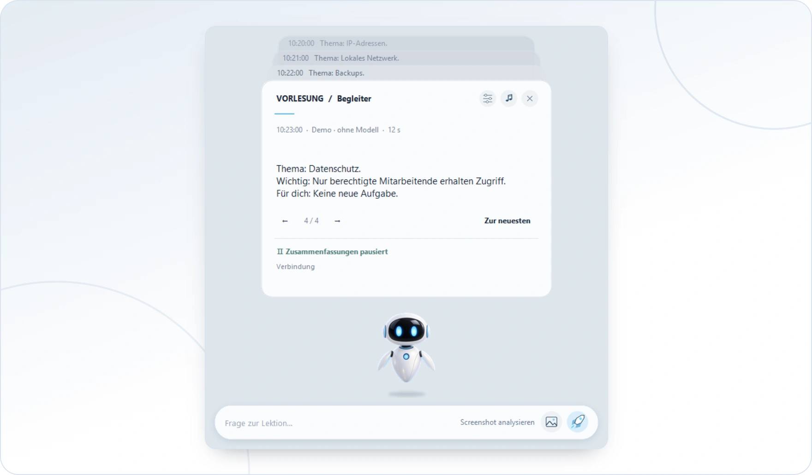

<!-- ppk-readme:head:start -->
<a href="https://popovantondev.github.io/LectureCompanion/index.html"><picture><source media="(prefers-color-scheme: dark)" srcset="https://raw.githubusercontent.com/popovantondev/LectureCompanion/main/docs/readme/header-de-dark.d82567ba.svg"></picture></a>
<!-- ppk-readme:head:end -->

# Lecture Companion

[Русский](README.ru.md) · **Deutsch** · [English](README.en.md)

<!-- ppk-readme:body:start -->

<a href="https://github.com/popovantondev/LectureCompanion/releases/tag/v2.4"><picture><source media="(prefers-color-scheme: dark)" srcset="https://raw.githubusercontent.com/popovantondev/LectureCompanion/main/docs/readme/btn-download-de-dark.8c37af51.svg"></picture></a>
<a href="https://popovantondev.github.io/LectureCompanion/index.html"><picture><source media="(prefers-color-scheme: dark)" srcset="https://raw.githubusercontent.com/popovantondev/LectureCompanion/main/docs/readme/btn-website-de-dark.87774505.svg"></picture></a>
<a href="https://popovantondev.github.io/LectureCompanion/Guide-de.html"><picture><source media="(prefers-color-scheme: dark)" srcset="https://raw.githubusercontent.com/popovantondev/LectureCompanion/main/docs/readme/btn-guide-de-dark.c97100f5.svg"></picture></a>
<a href="https://popovantondev.github.io/LectureCompanion/index.html"><picture><source media="(prefers-color-scheme: dark)" srcset="https://raw.githubusercontent.com/popovantondev/LectureCompanion/main/docs/readme/btn-demo-de-dark.ea8e303d.svg"></picture></a>
<a href="https://github.com/popovantondev/LectureCompanion/issues/new/choose"><picture><source media="(prefers-color-scheme: dark)" srcset="https://raw.githubusercontent.com/popovantondev/LectureCompanion/main/docs/readme/btn-bug-de-dark.2d244ac0.svg"></picture></a>

<a href="https://raw.githubusercontent.com/popovantondev/LectureCompanion/main/docs/screenshots/app-de.png"><picture><source media="(prefers-color-scheme: dark)" srcset="https://raw.githubusercontent.com/popovantondev/LectureCompanion/main/docs/readme/preview-de-dark.7799a5a1.webp"></picture></a> 
<a href="https://raw.githubusercontent.com/popovantondev/LectureCompanion/main/docs/screenshots/app-de.png">Ganzer Screenshot</a>

<picture><source media="(prefers-color-scheme: dark)" srcset="https://raw.githubusercontent.com/popovantondev/LectureCompanion/main/docs/readme/divider-dark.5ffb706c.svg"></picture>
<!-- ppk-readme:body:end -->

<!-- public-release:start -->
Begleitet Teams-Vorlesungen: fasst Untertitel lokal zusammen und erklärt eine ausgewählte Folie.

**Windows 11 · x64 · Vorabversion 2.4**

**[Herunterladen](https://github.com/popovantondev/LectureCompanion/releases/tag/v2.4)** · **[Anleitung](https://popovantondev.github.io/LectureCompanion/Guide-de.html)** · **[Fehler melden](https://github.com/popovantondev/LectureCompanion/issues/new/choose)**

**Voraussetzungen und Grenzen:** Teams Desktop und kompatible Treiber; empfohlen: 32 GB RAM, interne SSD und 25 GB freier Platz für Teile, ZIP und Entpacken. EXE nicht signiert; Prüfung auf einem zweiten sauberen PC steht aus.

**Erste Schritte:** Vier Teile und JoinPortable.cmd in denselben Ordner herunterladen (etwa 5,8 GB). JoinPortable.cmd prüft und verbindet sie; ZIP vollständig entpacken und LectureCompanion.exe öffnen.

**App-Dateien:**

- [`JoinPortable.cmd`](https://github.com/popovantondev/LectureCompanion/releases/download/v2.4/JoinPortable.cmd)
- [`LectureCompanion-2.4-Final-Portable.zip.part01`](https://github.com/popovantondev/LectureCompanion/releases/download/v2.4/LectureCompanion-2.4-Final-Portable.zip.part01)
- [`LectureCompanion-2.4-Final-Portable.zip.part02`](https://github.com/popovantondev/LectureCompanion/releases/download/v2.4/LectureCompanion-2.4-Final-Portable.zip.part02)
- [`LectureCompanion-2.4-Final-Portable.zip.part03`](https://github.com/popovantondev/LectureCompanion/releases/download/v2.4/LectureCompanion-2.4-Final-Portable.zip.part03)
- [`LectureCompanion-2.4-Final-Portable.zip.part04`](https://github.com/popovantondev/LectureCompanion/releases/download/v2.4/LectureCompanion-2.4-Final-Portable.zip.part04)

**Prüfsummen:** [`SHA256SUMS`](https://github.com/popovantondev/LectureCompanion/releases/download/v2.4/SHA256SUMS)
<!-- public-release:end -->

*Synthetische Demo. Kein echtes Meeting, keine echten Untertitel und keine Teilnehmerdaten.*

Lecture Companion hilft Ihnen, einer IT-Vorlesung in Microsoft Teams zu folgen. Die App fasst neue Liveuntertitel kurz zusammen und erklärt auf Wunsch die aktuell geteilte Folie. Die Verarbeitung erfolgt lokal auf dem PC — ohne API-Schlüssel oder Cloud-Fallback.

## Was die App kann

- Erkennt neue Untertitel getrennt vom bisherigen Kontext.
- Nimmt auf Knopfdruck einen frischen Ausschnitt der Bildschirmfreigabe auf — nicht das Besprechungschatfenster.
- Antwortet zuerst in der Sprache der Vorlesung und danach in der Oberflächensprache; gleiche Sprachen werden nicht doppelt ausgegeben.
- Zeigt bis zu zehn Antworten als navigierbare Kartenstapel; Fragen und Folienanalyse sind direkt erreichbar.
- Verwendet bevorzugt einen kompatiblen Intel NPU, sonst einen lokalen CPU-/GPU-Fallback.
- Unterstützt Deutsch, Englisch und Russisch für Oberfläche und neue Antworten.

## Rechtliches: nur mit Zustimmung aller Beteiligten

Lecture Companion liest Liveuntertitel aus der Teams-Desktop-App und wertet auf Knopfdruck einen Ausschnitt der Bildschirmfreigabe aus. Holen Sie vor jedem Meeting die Einwilligung aller Beteiligten ein (Lehrende und Teilnehmende) und beachten Sie die Regeln Ihrer Organisation. Bei Ablehnung oder Widerruf pausieren Sie die Zusammenfassungen oder beenden die App.

Auch wenn die App keinen Ton aufzeichnet: Das heimliche Aufzeichnen des nichtöffentlich gesprochenen Wortes kann nach [§ 201 StGB](https://www.gesetze-im-internet.de/stgb/__201.html) strafbar sein, und Untertitel sowie Folienbilder aus einem Meeting können personenbezogene Daten im Sinne der [DSGVO](https://www.edpb.europa.eu/sme/be-compliant/process-personal-data-lawfully_en) enthalten. Klären Sie Zweck, Umfang und Speicherort und stellen Sie vorab eine Rechtsgrundlage sicher, in der Regel die Einwilligung.

Die App verarbeitet Untertitel und Folienbilder lokal und speichert die letzten zehn Antworten im Ordner „Daten“; sie schreibt nichts in den Teams-Chat. Teilen Sie keine echten Untertitel, Screenshots oder Protokolle in öffentlichen Issues. Dieses Projekt stellt die Rechtmäßigkeit nicht fest und garantiert keine Datenschutzkonformität.

## Download und Start

Das Release 2.4 ist als Vorabversion öffentlich verfügbar. Laden Sie alle vier ZIP-Teile und `JoinPortable.cmd` von der [Release-Seite v2.4](https://github.com/popovantondev/LectureCompanion/releases/tag/v2.4) herunter und speichern Sie sie im selben Ordner. Starten Sie `JoinPortable.cmd` per Doppelklick; es prüft Dateigrößen und SHA-256, ohne etwas zu installieren. Entpacken Sie das erzeugte ZIP vollständig auf eine interne SSD und starten Sie `LectureCompanion.exe`. Die [deutsche Schritt-für-Schritt-Anleitung](https://popovantondev.github.io/LectureCompanion/Guide-de.html) erklärt die Nutzung.

- [Deutsche Schritt-für-Schritt-Anleitung](docs/USER_GUIDE.de.md)
- Windows 11 x64; 32 GB RAM empfohlen. Kompatible Treiber und die Teams-Desktop-App müssen bereits installiert sein.
- Erster Start und Modellinitialisierung können dauern. Das Paket ist mehrere GiB groß.

## Datenschutz und Grenzen

Untertitel und angeforderte Folienbilder werden lokal verarbeitet. Die App bietet keinen Cloud-Fallback und lädt sie nicht automatisch hoch. Meeting-Inhalte können personenbezogene Daten enthalten; Näheres steht unter „Rechtliches“.

Antworten können Fehler enthalten. Geschützte oder minimierte Teams-Fenster sowie Änderungen an Teams können den Zugriff auf Untertitel oder Folien verhindern. Gerätegeschwindigkeit und Kompatibilität hängen von PC und Treibern ab. Die EXE ist nicht signiert; ein Test auf einem sauberen zweiten Windows-PC steht noch aus.

## Dokumentation und Entwicklung

[Handbuch](docs/USER_GUIDE.de.md) · [Architektur und Build](docs/ENTWICKLUNG.de.md) · [Prüfbericht](VERIFICATION.md) · [Release-Checkliste](PUBLIC-REPOSITORY.md)

Für Quellcode-Prüfungen: `python verify.py --node PATH_TO_NODE`; native Windows-UI-Prüfungen: `--ui`. Die synthetische Demo startet ohne Teams oder Modellabfragen: `LectureCompanionDemo.exe` per Doppelklick.

## Nutzungsrechte

Der Quellcode und das Roboterbild sind öffentlich nur zur Ansicht verfügbar und nicht zur Wiederverwendung lizenziert. Die offizielle, unveränderte EXE darf privat und nicht kommerziell heruntergeladen und gestartet werden; Ändern oder Weiterverteilen ist nicht erlaubt. Drittanbieterkomponenten behalten ihre eigenen Lizenzen und Hinweise (`LICENSE`, `THIRD_PARTY.md`). GitHub kann Anzeigen und Forken öffentlicher Repositories erlauben; das ist keine technische Kopiersperre.
